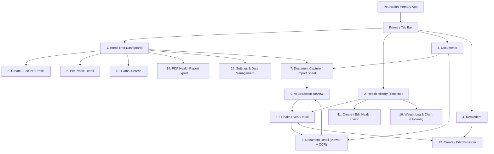
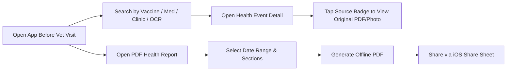
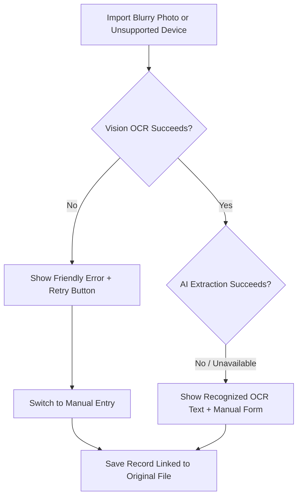

# UI/UX Design System, User Flows & User Stories — Pet Health Memory

**Related Docs:** [DESIGN_REVIEW.md](./DESIGN_REVIEW.md) (review findings and revised tokens)  
**Platform:** iOS (SwiftUI, iPhone-first, Dark Mode & Dynamic Type)

---

## 1. Design Direction

**Tone:** Calm, trustworthy, warm, and native iOS.  
Pet Health Memory sits between **medical record reliability** and **everyday pet care**. The interface avoids sterile hospital blues and overly playful cartoon themes, favoring soft natural tones, high readability, and fast single-handed capture.

### Key UX Rules
- **No heavy onboarding:** First launch goes directly into creating the first pet profile.
- **Fast capture:** Scanning or importing a document is always 1 tap away from Home and Documents.
- **Human-in-the-loop AI:** Extracted fields are clearly separated from confirmed records; uncertain or missing values are highlighted in Soft Amber and never auto-saved.
- **Source traceability:** Every AI-created record shows a tappable source badge linking back to the original document.
- **Complete UI states:** Every screen defines Empty, Loading, Error, Offline, and Destructive Confirmation states.

---

## 2. Color System & SwiftUI Tokens

### Palette (Light & Dark Mode)

| Token | Light Mode | Dark Mode | Usage |
| :--- | :--- | :--- | :--- |
| `brandPrimary` | `#4E8C7D` | `#6DB3A2` | Primary CTA buttons, active tab, medical accents |
| `brandPrimarySoft` | `#E7F2EF` | `#1F332E` | Subtle pill backgrounds, selected chips |
| `brandAccent` | `#E09A6C` | `#E8A87C` | Pet avatars, warm highlights, empty-state illustrations |
| `bgCanvas` | `#F8F7F4` | `#121413` | Main screen background (warm alabaster / deep charcoal) |
| `bgSurface` | `#FFFFFF` | `#1C1F1E` | Cards, timeline items, sheets |
| `bgElevated` | `#F1EFEA` | `#262A28` | Inputs, search bars, secondary containers |
| `textPrimary` | `#1E2422` | `#F2F4F3` | Headings, record titles, body copy |
| `textSecondary` | `#64706C` | `#9AA6A2` | Dates, metadata, subtitles |
| `borderSubtle` | `#E6E3DC` | `#2E3331` | Hairline dividers, card strokes |
| `statusSuccess` | `#3D9970` | `#52B788` | Confirmed records, completed reminders |
| `statusWarning` | `#D99B26` | `#E6B34B` | Uncertain/ambiguous AI fields, upcoming due dates |
| `statusDanger` | `#D65A5A` | `#E57373` | Overdue reminders, destructive delete actions |
| `statusSource` | `#5A84A2` | `#7AA6C4` | Source-linked document badges & provenance tags |

### Typography & Layout
- **Font:** Native Apple `SF Pro` (respects Dynamic Type from `xSmall` to `accessibilityExtraExtraLarge`).
- **Spacing Grid:** `4pt` base (`8`, `12`, `16`, `20`, `24`).
- **Card Corner Radius:** `16pt` for primary cards, `12pt` for inputs/chips, `20pt` for sheets.
- **Touch Targets:** Minimum `44x44pt` for all interactive elements.

### Motion & Animation Guidelines
- **Philosophy:** Subtle, tactile, purposeful — calm medical-grade feel, never blocking fast capture.
- **Default Curve:** `.spring(duration: 0.35, bounce: 0.15)`.
- **Accessibility:** Always respect `@Environment(\.accessibilityReduceMotion)` (fall back to simple opacity fade when enabled).
- **Key Motion Moments:**
  1. **OCR & AI Processing:** Soft shimmer/scanline over the document thumbnail with smooth step transitions (`Reading text → Extracting fields → Ready to review`).
  2. **Document Zoom Transition:** `.navigationTransition(.zoom(...))` from document thumbnails and *Source-linked* timeline badges to Document Detail.
  3. **AI Extraction Review Confirm:** Confirmed cards collapse smoothly with `.sensoryFeedback(.success, ...)` before navigating to Timeline.
  4. **Reminder Complete / Snooze:** Animated checkmark + subtle light haptic + smooth move to Completed group.
  5. **Pet Switcher & Timeline Filters:** `matchedGeometryEffect` sliding pill + crisp `0.2s` content crossfade.
- **Avoid:** Long splash animations, decorative bounce, or blocking modals during quick vet-clinic capture.

### Multi-Platform Support (iOS + macOS)
- **Shared Core (80–90%):** SwiftUI views, SwiftData models, Vision OCR, Foundation Models extraction, PDFKit export, and `Theme.swift` (using `#if canImport(UIKit)` / `#if canImport(AppKit)`).
- **Adaptive Navigation:**
  - **iPhone:** 4-tab `TabView` (`Home`, `Health History`, `Documents`, `Reminders`).
  - **macOS / iPadOS:** `NavigationSplitView` (Pet selector + navigation sidebar → record/document list → detail inspector).
- **macOS-Specific Enhancements:**
  - Drag & Drop PDFs/images directly onto the window (ideal for lab reports/invoices received via email).
  - Side-by-side split view for **AI Extraction Review** (original PDF on the left, editable extracted fields on the right).
  - Keyboard shortcuts (`⌘F` Search, `⌘I` Import Document, `⌘E` Export PDF, `⌘N` New Health Event).
  - Platform guards: camera capture only under `#if os(iOS)`, file picker / drag-and-drop available on both platforms.

### Sync UX (iCloud Sync & Optional Backend Sync)
- **Offline-First Default:** Local SwiftData remains the single source of truth; UI never blocks waiting for network.
- **Sync Options (User-Controlled in Settings):**
  - **Local Only (Default):** Zero external sync.
  - **iCloud Sync (CloudKit):** Seamless Apple-ecosystem sync across iPhone, iPad, and Mac.
  - **Optional Backend Sync:** Connects to FastAPI `/api/v1/sync/pull` & `/push` + S3/R2 presigned document storage for cross-platform sharing (`/share/:token`).
- **Sync Indicators:** Subtle, non-intrusive status indicator in Settings/Home (`Local only`, `Synced`, `Syncing…`, `Offline — changes saved locally`).

> **Handoff Note for UI Implementation (Claude Opus):** Feel free to refine layouts, component hierarchy, micro-interactions, macOS split-view ergonomics, or sync status UX wherever it improves clarity and polish — while strictly preserving the PRD non-negotiables (no auto-saving AI extractions without confirmation, no medical/dosage recommendations, original documents always preserved and source-linked).

---

## 3. Information Architecture (15 MVP Screens)

---

## 4. Core User Flows

### Flow A — First Launch & Document-to-Timeline (Primary Value Flow)

```mermaid
flowchart LR
    Start["First Launch"] --> Pet["Create Pet Profile"]
    Pet --> Home["Pet Dashboard"]
    Home --> Import["Scan / Import Document"]
    Import --> SaveOrig["Preserve Original File Locally"]
    SaveOrig --> OCR["On-Device Vision OCR"]
    OCR --> CheckAI{"Foundation Models Available?"}
    CheckAI -->|Yes| Extract["Structured AI Extraction"]
    CheckAI -->|No| Fallback["OCR Text + Manual Entry"]
    Extract --> Review["AI Extraction Review Screen"]
    Review --> Edit["Edit / Fix Highlighted Fields"]
    Edit --> Confirm{"User Confirms?"}
    Confirm -->|Yes| CreateEvent["Save Source-Linked HealthEvent"]
    Confirm -->|Discard| KeepDoc["Keep Original Document Only"]
    Fallback --> CreateEvent
    CreateEvent --> AskReminder["Optional: Add Reminder"]
    AskReminder --> Timeline["View on Health Timeline"]
```

### Flow B — Appointment Preparation, Search & PDF Export

### Flow C — OCR / AI Failure & Reliability Fallback

---

## 5. User Stories & Acceptance Criteria

### Epic 1 — Pet Profile & Foundation
- **US-01 (Create Pet):** As a pet owner, I want to create my pet's profile in under 30 seconds without signing up, so I can start organizing records immediately offline.
  - *Done when:* Profile saves locally in SwiftData, persists across restarts, and displays on Home.
- **US-02 (Manage Pet):** As a pet owner, I want to edit or safely delete a pet profile with a confirmation dialog, so I stay in full control of my data.
  - *Done when:* Editing updates immediately; deletion requires confirmation and cleans up associated local files.

### Epic 2 — Document-to-Timeline & Source-Linked Records
- **US-03 (Fast Import):** As a pet owner at a vet clinic, I want to snap a photo of a paper vaccination card or import a PDF from Files, so the original record is safely archived on my iPhone.
  - *Done when:* Original image/PDF is stored in app-private storage and viewable offline in Document Detail.
- **US-04 (On-Device OCR):** As a privacy-conscious owner, I want text recognized locally via Apple Vision without uploading my files, so my documents become searchable offline.
  - *Done when:* OCR runs on-device, stores text on the document, and supports retry if it fails.
- **US-05 (Reviewable AI Extraction):** As a pet owner, I want to review, edit, or discard AI-extracted fields alongside the original document before saving, so inaccurate data never pollutes my pet's medical history.
  - *Done when:* Missing/ambiguous fields are visually highlighted in amber, medication instructions are never altered, and zero records are saved until the user taps **Confirm**.
- **US-06 (Source Traceability):** As a pet owner showing records to a new vet, I want to tap a timeline entry and immediately open the original clinic document, so the vet can verify the exact source.
  - *Done when:* Confirmed events retain `sourceDocumentId` and open the linked Document Detail in 1 tap.

### Epic 3 — Health History, Vaccinations & Medications
- **US-07 (Chronological Timeline):** As a pet owner, I want to view all visits, vaccinations, medications, lab results, and notes in one chronological timeline, so I can understand my pet's history at a glance.
  - *Done when:* Events sort chronologically, filter by type, and support full create/edit/delete.
- **US-08 (Vaccination & Medication Tracking):** As a pet owner, I want to track vaccine dates/due dates and mark medications as active or completed without the app giving unsolicited medical advice.
  - *Done when:* Records store exact user/document text; no automatic vaccine schedules or dosage calculations are generated.

### Epic 4 — Reminders, Search & Appointment Preparation
- **US-09 (Reliable Local Reminders):** As a pet owner, I want to schedule, snooze, complete, and repeat vaccination/medication reminders that work offline, so I never miss a dose or booster.
  - *Done when:* Notification permission is requested contextually and `UNUserNotificationCenter` state reconciles on every app launch.
- **US-10 (Instant Offline Search):** As a pet owner in the exam room, I want to search by vaccine name, medication, clinic, note, or text inside scanned documents offline, so I can answer the vet's questions in seconds.
  - *Done when:* Search returns accurate, read-only results across records and OCR text and opens the matching item directly.

### Epic 5 — Export & Reliability
- **US-11 (Offline PDF Health Report):** As a pet owner switching clinics or traveling, I want to choose a date range and sections to generate and share a clean PDF summary offline.
  - *Done when:* PDF generates locally via `PDFKit` and opens the native iOS Share Sheet without network access.
- **US-12 (Graceful Fallback):** As a user on an iPhone without Apple Foundation Models, I want OCR and manual entry to still work seamlessly, so the app remains fully useful.
  - *Done when:* Runtime availability check routes smoothly to OCR + manual entry without crashing or blocking the user.
